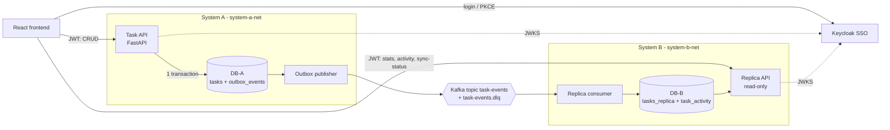

# Task Platform — two systems kept in sync by Kafka

A small local platform that demonstrates **two independent systems staying in sync only through Apache Kafka**:

- **System A (task app)** owns the tasks (source of truth): FastAPI Task API + PostgreSQL (DB-A) + a transactional-outbox publisher.
- **System B (replica & analytics)** has its *own* database (DB-B), never touches DB-A and never calls System A. It builds its copy of the data and an activity log purely from Kafka events.
- **Keycloak** does SSO (authentication only). **Kafka** does not handle auth; Keycloak does not touch Kafka.



Separation is enforced structurally, not by convention:

| Network        | Members                                                         |
|----------------|-----------------------------------------------------------------|
| `system-a-net` | db-a, task-api, outbox-publisher (+ keycloak, for JWKS)         |
| `system-b-net` | db-b, replica-consumer, replica-api (+ keycloak, for JWKS)      |
| `kafka-net`    | kafka, kafka-init, outbox-publisher, replica-consumer           |

Each DB has its own user/password. The Task API cannot even resolve `db-b`; the replica containers cannot resolve `db-a`.
Only the opt-in `tools` container (used by `make compare` / `make seed`) is attached to both system networks.

## Run it

Requirements: Docker with Compose v2. Nothing else (Python and Node run in containers).

```bash
docker compose up --build        # or: make up   (detached, waits for health)
```

| What               | URL                              |
|--------------------|----------------------------------|
| Frontend           | http://localhost:5173            |
| Task API (System A)| http://localhost:8001/docs       |
| Replica API (B)    | http://localhost:8002/docs       |
| Keycloak           | http://localhost:8080 (admin / admin) |
| Kafka (from host)  | `localhost:29092`                |

**Demo login:** `demo` / `demo1234`

Configuration lives in `.env` (copy `.env.example`); every value has a working default in `docker-compose.yml`.
If host port 8080 is taken, set `KEYCLOAK_PORT=8180` **and** `KEYCLOAK_PUBLIC_URL=http://localhost:8180` in `.env`
(the public URL is baked into the frontend build and is the token `iss`, so rebuild with `docker compose up --build`).

### Keycloak notes
- Realm `taskapp` is imported from `keycloak/realm-export.json`. Client `task-frontend` is public, Authorization Code + **PKCE (S256)**.
- The browser reaches Keycloak at `localhost:8080`, containers at `keycloak:8080`. `KC_HOSTNAME` pins the public URL so
  the token `iss` is always `http://localhost:8080/realms/taskapp`. Both APIs fetch JWKS from the *internal* URL
  (`KEYCLOAK_JWKS_URL`) but validate `iss` against the *public* one (`KEYCLOAK_ISSUER`).
- `sub` is the user id everywhere (`tasks.created_by`, `event.user_id`).

## Seed, test, compare

```bash
make seed            # ~30 tasks via the Task API -> outbox -> Kafka -> System B -> dashboard
make compare         # compare_systems.py: A and B agree on ids/titles/statuses/versions? (exit 0 = yes)
make test            # pytest: Task API (27), replica consumer (16), replica API (7)
```

`make seed` authenticates as `demo` through a dedicated dev-only client `task-seeder` that has direct-grant enabled
(Keycloak's token endpoint), then calls the real Task API. Seeded titles are stable (`[seed] ...`) and titles that already
exist are skipped, so running it twice does not duplicate data.

Tests run in containers against throwaway databases (`tasks_test`, `replica_test`, `replica_api_test`) on the same Postgres
servers, so they never touch the demo data.

## Demos

### 1. Kafka outage (System A keeps working)
```bash
docker compose stop kafka
# in the UI: create / edit tasks -> still works. Indicator turns "Catching up…", stats/activity go stale.
docker compose exec db-a sh -c 'psql -U $POSTGRES_USER -d $POSTGRES_DB -c "select event_type, published_at from outbox_events order by created_at desc limit 5"'
docker compose start kafka        # publisher retries with backoff; events flow; B catches up
make compare
```

### 2. System B outage
```bash
docker compose stop replica-consumer
# make changes: task list works normally; stats + activity go stale
docker compose start replica-consumer   # resumes from its committed offset; no duplicate activity rows
make compare
```

### 3. Rebuild System B from Kafka
```bash
make rebuild-replica
```
Stops the consumer, truncates `tasks_replica` and `task_activity`, resets the `replica-consumer` group to earliest, restarts it,
waits for lag 0, then runs `compare_systems.py`. The topic has `retention.ms=-1`, so history is never lost.

## API summary

**System A — Task API** (`/tasks*` need `Authorization: Bearer <jwt>`; others' tasks return 404)
`GET /health` · `GET /tasks?status=&limit=&offset=` · `POST /tasks` · `GET|PUT|DELETE /tasks/{id}`
Statuses: `pending`, `in_progress`, `completed`. Every task has an integer `version` (starts at 1, +1 on every change).

### Task fields
All 14 are standard columns stored directly on the task row, with no related tables, foreign keys or join structures.
Each task owns its own values. List-type fields are JSONB arrays on the same row.

| Field | Type | Notes |
|---|---|---|
| `title` | text, required | max 200 chars |
| `project` | text, optional | |
| `status` | enum | `pending` (default) / `in_progress` / `completed` |
| `description` | text, optional | |
| `attachments` | list of `{name, url, content_type, size}` | references/links stored inline (no file storage), max 20 |
| `parent_task` | task id, optional | plain id, no FK; must be one of your own tasks and not the task itself |
| `priority` | enum | `low` / `medium` (default) / `high` / `critical` |
| `assignees` | list of text | trimmed, de-duplicated, max 50 |
| `lead_institution` | text, optional | |
| `supporting_institutions_within_gsas` | list of text | |
| `supporting_institutions_outside_gsas` | list of text | |
| `date_issued` | date | defaults to today (UTC) |
| `due_date` | date, optional | |
| `labels` | list of text | |

The fields travel in every event snapshot and are stored on System B's `tasks_replica` row, and `make compare` checks all of them.
Events published before these fields existed still replay (missing fields take defaults; `date_issued` falls back to the creation date).

**System B — Replica API** (read-only, scoped to the caller's `sub`)
`GET /health` · `GET /stats` · `GET /activity?limit=20` · `GET /sync-status`

## How consistency works

- **Transactional outbox.** Each create/update/delete writes the task change *and* an `outbox_events` row in one DB-A
  transaction (completion writes `task.updated` + `task.completed`). The Task API never talks to Kafka.
- **Publisher.** Claims unpublished rows with `FOR UPDATE SKIP LOCKED`, publishes with the task id as key
  (idempotent producer, `acks=all`), waits for delivery reports and only then sets `published_at`. Backs off and
  retries if Kafka is down. Duplicates after a crash are fine: consumers are idempotent.
- **Events are self-contained**: full task snapshot + `version` (for deletes, the last snapshot at the tombstone version),
  so System B never queries System A.
- **Consumer.** Per message, one DB-B transaction: insert `task_activity` (`ON CONFLICT (event_id) DO NOTHING`) and apply
  the event to `tasks_replica`, then commit the Kafka offset synchronously. Upserts apply only if `event.version >
  row.version`; a `task.deleted` event physically deletes the row from `tasks_replica` (as in System A); nothing is kept.
  Because no tombstone remains, a stale create/update for an already-deleted task that is redelivered later would re-create it
  (known trade-off). Malformed messages go to `task-events.dlq` with the reason in headers.

## Why Kafka here

- **Decoupling.** System A publishes facts about what happened; it doesn't know who consumes them or call anyone.
- **Independent availability.** If B (or Kafka) is down, A keeps accepting writes; the outbox buffers events. If A is down, B still serves its last known data.
- **Eventual consistency.** B lags A slightly. The UI makes that visible ("In sync" / "Catching up…") instead of hiding it.
- **Idempotent, order-safe consumers.** Kafka guarantees order only per partition/key and delivers at-least-once; the version guard and `event_id` dedup make that safe.
- **Replay and rebuild.** The log is the history. Wipe DB-B, replay from offset 0, get the same state (`make rebuild-replica`).
- **Add a consumer without touching A.** A search indexer, notification sender or warehouse loader just subscribes to `task-events`
  with its own consumer group and its own storage; System A, its DB and the existing consumers don't change.

Kafka does not replace the databases (they hold current state and enforce ownership) and does not do authentication.

## Layout

```
docker-compose.yml  .env.example  Makefile
keycloak/realm-export.json
common/taskcommon/            JWT validation, event schema, migration runner (no DB access across systems)
system-a/task-api/            CRUD, owns DB-A (SQL migrations run on startup)
system-a/outbox-publisher/    DB-A -> Kafka
system-b/replica-consumer/    Kafka -> DB-B
system-b/replica-api/         read-only API over DB-B
system-b/migrations/          DB-B schema (used by both System B services)
frontend/                     React + Vite + TS + keycloak-js
scripts/                      seed_tasks.py, compare_systems.py, rebuild_replica.sh
tests/                        pytest suites + shared Dockerfile for tests/tools
```

## Known limitations (demo scope)
- Single-node Kafka, replication factor 1, no auth/TLS on Kafka; Keycloak runs `start-dev` with an in-container H2 database
  (realm is re-imported when the container is recreated). Not production settings.
- "Completed in the last 7 days" uses the task's `updated_at` (there is no separate `completed_at`).
- The frontend's sync indicator compares totals and the latest `updated_at` between A and B; it is a good heuristic, not a proof of equality (`make compare` is).
- The `[seed]` re-run rule is by title, so editing a seeded task's title makes the next seed re-create it.
